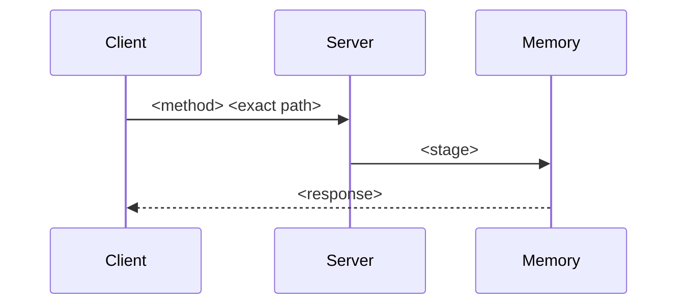
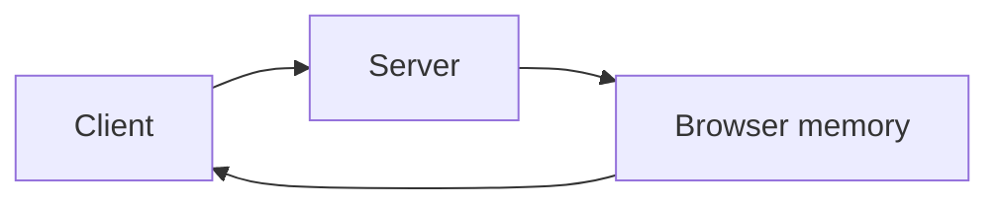

# Architecture

## Assumptions

Choices made because the request said to pick. Empty when every stack and schema decision came from the user.

## Problem and non-goals

What the product does, and what it will not do.

## Stack

One stack. Name the client, server, database, and the test and dev commands.

## Runtime

Client, server, database, and any third party. The system map is the flowchart drawn from the route traces.

## Route traces

Write this section first. One block per operation. An operation is one exact HTTP route or one in-process call. Operations do not share a block. The system map and the API catalog are filled from these blocks and add no operation of their own.

### <operation id>

caller: the screen and the control that starts it
request: method, exact path, and every field with its type. An in-process call lists its arguments instead of a path.
handler: what runs, in order
stages: each stage touched, in order. A stage is browser memory, the server, a named table, a file, a third party, or none.
response: status and every response field with its type
screen: what changes on success, on the empty state, and on each error
diagram: a mermaid sequence of the stages in this trace. A participant that is not a stage in this trace is not in the diagram.

## System map

One mermaid flowchart, drawn from the route traces. Nodes are the stages those traces name: the client, the server, browser memory, every table, and every other stage a call can touch. Each trace is its own arrow from the caller through that trace's stages, in order, and back to the screen. The arrow label is the trace id. A trace with no arrow is unfinished. A node or arrow that no trace contains is not allowed.

## Journeys

One section per primary journey. Each journey has all six hops:

1. Screen and the fields or actions on it.
2. Request: method, path, body. Name the route-trace id.
3. Handler: validation and side effects.
4. Tables written or read, and the invariant. Name the stage from that trace.
5. Response: status and body.
6. What the screen does with that response, including the empty and error states.

Name the route-trace ids this journey uses. A journey does not add an operation that has no trace.

## Data model

Tables, columns, relations, and invariants.

## API catalog

One row copied from each route trace. The row id, call, request, response, caller, and stages come from that trace. Several operations do not share a row. A row with no trace is not allowed.

| id | call | request | response | errors | caller | stages |
| --- | --- | --- | --- | --- | --- | --- |
| <operation id> | method and exact path, or the function signature | | | | | |

## Screen catalog

Each screen and the route-trace ids it calls. A screen does not call an operation that has no trace.

## Auth

Who can do what. "None" is a valid choice when the product has no accounts.

## Error and empty states

The states a person can actually see.

## Open decisions

Empty when the contract is ready to plan. A planner stops while this section has an item.
